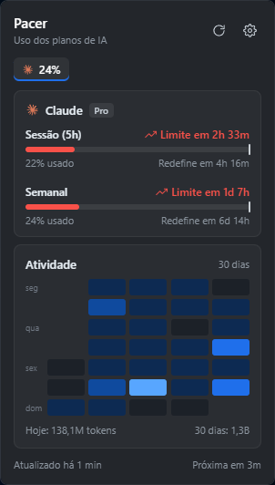
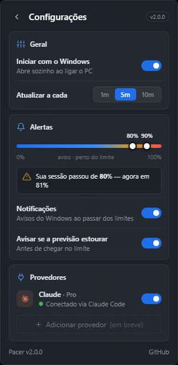
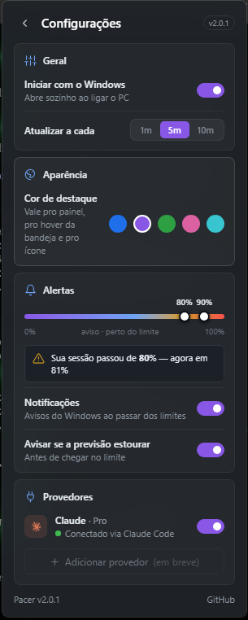
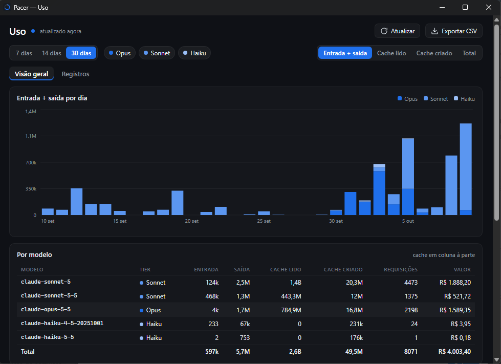
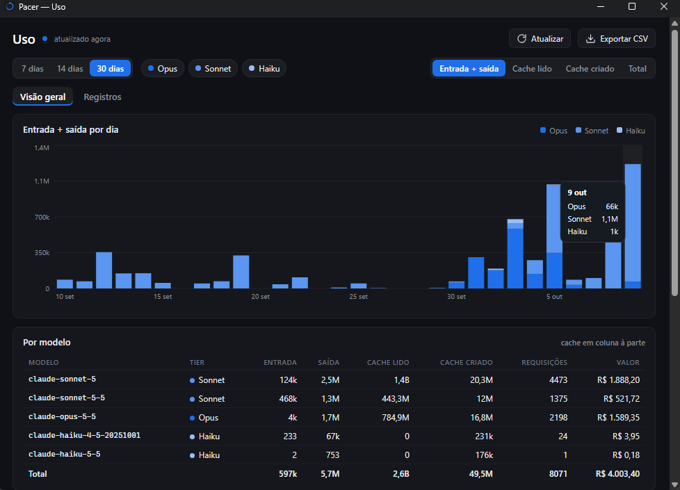

# Pacer

**English** · [Português](README.md) · [Website](https://pacercontrol.netlify.app/)

> **Note:** the app's interface is in Brazilian Portuguese.

A Windows widget that shows how much of your AI plan you've already used — and
**where your current pace will take you** before the limit resets.



## What it shows

- Claude's **5-hour session and weekly** usage, with the real percentage from
  Anthropic
- **Pace projection**: the white mark on each bar shows where you'll be when
  the window resets; if you're going to run out, it says "Nesse ritmo, acaba em 1d 7h"
  ("at this pace, runs out in 1d 7h")
- **Last 30 days of activity** in a GitHub-style grid, built from Claude Code's
  local logs
- Windows **notifications** when you cross each threshold (80% and 95% by
  default) and when the projection says you'll hit the limit before the reset
- A tray icon whose color follows your usage, with a visual popup on hover
  (session and weekly, no need to open the panel)
- Configurable **accent color** (5 presets) — applies to the panel, the hover
  popup and the tray icon together. Warning (orange) and critical (red) stay
  fixed, so the alert signal never gets lost




## Usage panel

Click the chart icon in the widget header (or **Abrir painel de uso** in the tray
menu) to open a separate window with the detailed consumption. It is a regular
window that only exists while you have it open and is destroyed on close — the
widget stays light.

- **By day and by tier**: stacked chart of Opus/Sonnet/Haiku, with a period
  filter (7/14/30 days) and a tier filter. The chart metric is selectable,
  because cache reads are usually orders of magnitude larger than input + output
- **By model**: input, output, cache read and cache creation kept apart — cache
  is **not** added into the consumption number, which is what used to inflate it
- **Rankings**: which sessions and which projects consumed the most
- **Records**: the 200 most recent requests, plus **Exportar CSV** (written to
  Downloads) with the same columns
- **Estimated value** at API prices, in BRL, using the official price table and
  the exchange rate you set in Settings. Subscription users don't pay this — it
  is a reference, not an invoice. A model missing from the table gets **no**
  value, and the panel says so instead of guessing a number




> The per-model and per-request value is an **estimate at API prices** (price
> table read on 2026-10-10). The dollar rate is editable in Settings → Valor
> estimado.

## Requirements

- Windows 10/11
- [Claude Code](https://claude.com/claude-code) installed and logged in — the
  login and the logs come from it

## Install

Download the installer from the [website](https://pacercontrol.netlify.app/) or
from [Releases](https://github.com/sthevan027/pacer/releases) and run it. Since 2.0.1 the installer is **signed with the Sthevan.Dev certificate**
(self-signed, not from a commercial authority), so Windows may still show
"Windows protected your PC" → **More info → Run anyway**. To have Windows recognize
the signature, trust the `Sthevan.Dev-Root-CA.cer` published with the release once
(optional).

### Run from source

Requires Rust, Bun and Visual Studio Build Tools (C++).

```bash
bun install
bun run tauri dev     # development
bun run tauri build   # installer in src-tauri/target/release/bundle/nsis/
```

Tests: `cargo test --manifest-path src-tauri/Cargo.toml` and `bun run test`.

## Privacy

- Pacer **reads** `~/.claude/.credentials.json` (Claude Code's login) and
  **never writes to it or refreshes the token** — Claude Code does that itself.
- The token never reaches the UI; it stays in the Rust process.
- It only talks to `api.anthropic.com`. No telemetry.
- Settings live in `%APPDATA%\dev.sthevan.pacer\config.json`.
- The panel reads Claude Code's local logs, so it shows **project folder names
  and session identifiers**. That stays on your machine, but note: the **exported
  CSV contains those names** — don't publish the file without checking it.

## Credits

Style inspired by Fabio Akita's [ai-usagebar](https://github.com/akitaonrails/ai-usagebar)
(MIT), which is also where the Claude symbol used in the app comes from.

## License

MIT
